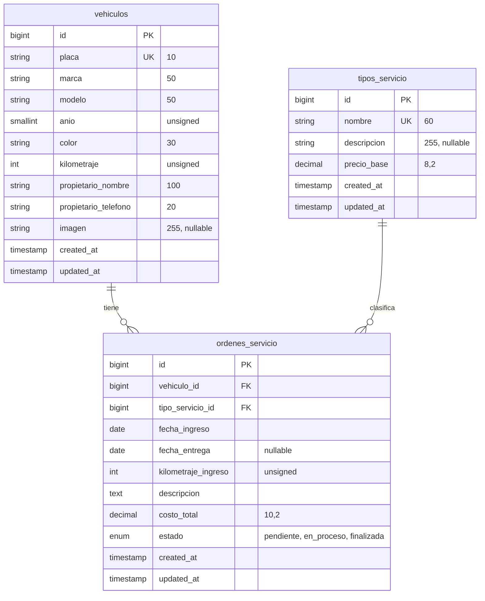

# Biela

*Fichas de vehículos y órdenes de servicio*

Proyecto final de **Desarrollo Web con Software Libre**, Facultad de Ingeniería y Arquitectura, Universidad Católica de El Salvador (UNICAES).
Caso 8, Taller mecánico. Equipo 8.

| Integrante | Usuario de GitHub |
| --- | --- |
| Carlos | [@jojosenthusiast](https://github.com/jojosenthusiast) |
| Ángel | [@angelcoto-stack](https://github.com/angelcoto-stack) |
| Jorge | [@JorgeRamos2001](https://github.com/JorgeRamos2001) |
| Leonel | [@leonelgit](https://github.com/leonelgit) |
| Fernando | [@fernandovalle45](https://github.com/fernandovalle45) |
| Milton | [@Milton84-toc](https://github.com/Milton84-toc) |

## 1. Descripción

Biela registra los vehículos que ingresan a un taller mecánico y las órdenes de servicio que se les realizan. El nombre es el de la pieza que une el pistón con el cigüeñal.

**Fase 1 (30 %)** incluye:

- Proyecto Laravel con conexión a MySQL o MariaDB mediante variables de entorno.
- Tres migraciones con llaves foráneas y restricciones, y tres modelos Eloquent con sus relaciones.
- Datos de prueba con factories y seeders.
- Listado paginado de vehículos con miniatura, ficha de detalle, catálogo de servicios y panel de resumen.
- Este README con el diagrama entidad-relación.

**Fase 2 (100 %)** agrega el CRUD completo, validación con Form Requests, manejo de imágenes y las reglas de negocio del caso.

## 2. Requisitos

| Requisito | Versión |
| --- | --- |
| PHP | 8.3 o superior (desarrollado con 8.4) |
| Composer | 2.x |
| Laravel | 13 (se comprueba con `php artisan --version`; desarrollado con 13.40) |
| Base de datos | MySQL o MariaDB local (XAMPP o Laragon) |

Extensiones de PHP necesarias: `pdo_mysql`, `mbstring`, `openssl`, `fileinfo`, `xml`, `curl` y `zip`.
Se comprueban con `php -m`.

La interfaz usa CSS propio, sin Bootstrap ni Tailwind, y no requiere `npm`.

## 3. Instalación

1. `git clone <url del repositorio>` y `cd proyecto-final-laravel-equipo8`
2. `composer install`
3. Copiar `.env.example` a `.env`
4. `php artisan key:generate`
5. Crear una base vacía llamada `taller_mecanico` y revisar usuario y contraseña en `.env`
6. `php artisan migrate --seed`
7. `php artisan storage:link`
8. `php artisan serve` y abrir `http://127.0.0.1:8000`

Las tablas se crean únicamente con migraciones. Solo la base vacía se crea a mano.

## 4. Modelo de datos



## 5. Tablas y relaciones

| Tabla | Modelo | Relaciones |
| --- | --- | --- |
| `tipos_servicio` | `TipoServicio` | `ordenes()` hasMany `OrdenServicio` |
| `vehiculos` | `Vehiculo` | `ordenes()` hasMany `OrdenServicio` |
| `ordenes_servicio` | `OrdenServicio` | `vehiculo()` belongsTo `Vehiculo`, `tipoServicio()` belongsTo `TipoServicio` |

Cada modelo declara su tabla con `protected $table`, porque Laravel pluraliza en inglés y buscaría `tipo_servicios` y `orden_servicios`, que no existen.
Cada modelo define `$fillable` y `casts()` para proteger la asignación masiva y tipar fechas, dinero y enteros.

### Por qué `restrictOnDelete`

Las dos llaves foráneas de `ordenes_servicio` usan `restrictOnDelete()`. Un taller no pierde el historial de un vehículo ni borra un tipo de servicio que ya tiene órdenes. En la Fase 2 el borrado mostrará un mensaje claro en lugar de una excepción.

### Reglas de negocio (pendientes para la Fase 2)

Se validarán en el servidor durante la Fase 2:

1. Placa única con formato definido por el equipo (`P` y seis dígitos, por ejemplo `P123456`).
2. Año del vehículo entre 1980 y el año actual + 1.
3. El kilometraje de ingreso no puede ser menor que el último registrado para el vehículo.
4. La fecha de entrega no puede ser anterior a la de ingreso.
5. Una orden finalizada no puede editarse.

## 6. Vehículos

*Sección de Jorge (bloque 3).*

El listado `/vehiculos` muestra los vehículos ordenados por placa, de 10 en 10, con su miniatura, marca y modelo, año, kilometraje, propietario con su teléfono y la cantidad de órdenes de servicio. Debajo de la tabla se indica el rango visible ("Mostrando 1 a 10 de 20 vehículos") y los enlaces de paginación. Si no hay vehículos aparece "Todavía no hay vehículos registrados."

### Datos de prueba

`VehiculoSeeder` crea 20 vehículos con `VehiculoFactory`. Cada marca solo genera sus propios modelos (por ejemplo, Toyota con Corolla o Hilux), el año va de 1995 al año actual y el kilometraje de 5 000 a 250 000 km.

### Formato de la placa

La placa es una `P` seguida de seis dígitos, por ejemplo `P123456`. La columna es única en la migración. La factory ya respeta el formato y la validación se agrega en la Fase 2.

### Imagen por defecto

Los vehículos sin foto muestran `public/img/vehiculo-default.svg`, que sí se versiona. Las vistas nunca arman la ruta a mano: usan el accesor `imagen_url` del modelo `Vehiculo`, que devuelve la foto subida a `storage/app/public` si existe o la imagen por defecto si no. Los datos de prueba dejan `imagen` en `null`.

### Filtro por marca

El formulario de arriba de la tabla filtra por marca con `?marca=`. Las opciones salen de las marcas que hay en la base, no de una lista escrita a mano. El valor llega a la consulta con `where()` de Eloquent, nunca concatenado en el SQL, y `withQueryString()` hace que la paginación conserve el filtro.

### Cómo comprobarlo

```bash
php artisan migrate:fresh --seed
php artisan route:list --name=vehiculos
```

La segunda orden debe listar únicamente `vehiculos.index` (`GET /vehiculos`). Después, con `php artisan serve`:

- `http://127.0.0.1:8000/vehiculos` muestra 10 vehículos y la página 2 muestra los otros 10.
- `http://127.0.0.1:8000/vehiculos?marca=Toyota` muestra solo esa marca. Las marcas se reparten al azar, así que conviene elegir una que aparezca en el filtro.


## Órdenes y resumen del taller

### 1. Órdenes de servicio

El sistema Biela permite consultar las órdenes de servicio
asociadas a los vehículos registrados en el taller.

Cada orden contiene:

- Vehículo asociado.
- Tipo de servicio realizado.
- Fecha de ingreso.
- Fecha de entrega, cuando corresponde.
- Kilometraje al momento del ingreso.
- Descripción del trabajo.
- Costo total.
- Estado de la orden.

Las órdenes se relacionan con los vehículos y los tipos
de servicio mediante los modelos Eloquent de Laravel.

### 2. Estados de las órdenes

Las órdenes pueden presentar tres estados:

**Pendiente:** el servicio está registrado, pero todavía
no ha comenzado.

**En proceso:** el vehículo se encuentra recibiendo
el servicio correspondiente.

**Finalizada:** el servicio se ha completado y la orden
tiene registrada una fecha de entrega.

En los datos de prueba, las órdenes pendientes y en proceso
no tienen fecha de entrega.

Las órdenes finalizadas tienen una fecha de entrega igual
o posterior a la fecha de ingreso.

### 3. Generación de órdenes de prueba

El archivo OrdenServicioFactory.php genera los datos
iniciales de cada orden.

El archivo OrdenServicioSeeder.php utiliza esa Factory
para registrar órdenes de servicio asociadas a vehículos
y tipos de servicio existentes.

El proceso funciona de la siguiente manera:

1. Se consultan los tipos de servicio registrados.
2. Se seleccionan los primeros 12 vehículos.
3. Se generan entre 1 y 3 órdenes para cada vehículo.
4. Los estados se distribuyen entre pendiente,
   en_proceso y finalizada.
5. El kilometraje aumenta progresivamente para cada
   vehículo conforme avanzan las fechas.
6. Las órdenes finalizadas reciben una fecha de entrega
   posterior a su ingreso.

Los ocho vehículos restantes quedan sin órdenes de
servicio para comprobar posteriormente el historial vacío.

La cantidad de órdenes generadas puede variar entre
12 y 36 registros.

### 4. Panel de resumen

La página principal del sistema se encuentra en la ruta:

GET /

Esta ruta utiliza PanelController@index para consultar
los datos de MySQL mediante Eloquent.

El panel muestra cinco indicadores:

- Vehículos registrados: cantidad total de vehículos.
- Órdenes de servicio: cantidad total de órdenes.
- Pendientes: órdenes con estado pendiente.
- En proceso: órdenes con estado en_proceso.
- Finalizadas: órdenes con estado finalizada.

La suma de los tres estados debe coincidir con
el total de órdenes de servicio.

### 5. Servicios más solicitados

El panel incluye una tabla que muestra todos los
tipos de servicio y la cantidad de órdenes asociadas.

La información se obtiene mediante la relación
ordenes() del modelo TipoServicio.

Se utiliza withCount('ordenes') para calcular
los totales y ordenar los servicios de mayor a menor.

### 6. Últimas órdenes

El panel muestra las cinco órdenes de servicio
más recientes.

La tabla contiene:

- Placa del vehículo.
- Tipo de servicio.
- Fecha de ingreso.
- Estado de la orden.

Las relaciones vehiculo y tipoServicio se cargan
anticipadamente mediante with() para evitar
consultas adicionales por cada registro.

La placa permite acceder a la ficha del vehículo.
Esta funcionalidad se completará en el módulo
asignado a Fernando.

### 7. Comprobación de los datos

Para preparar una base de datos local de prueba
desde cero, ejecutar:

php artisan migrate:fresh --seed

ADVERTENCIA: este comando elimina las tablas
existentes y sus datos. No debe utilizarse en una
base de datos con información que se necesite conservar.

Para iniciar el servidor:

php artisan serve

Abrir en el navegador:

http://127.0.0.1:8000

Para comprobar los registros, ejecutar:

php artisan tinker

Dentro de Tinker, utilizar las siguientes consultas:

Total de vehículos:

\App\Models\Vehiculo::count();

Total de órdenes:

\App\Models\OrdenServicio::count();

Órdenes pendientes:

\App\Models\OrdenServicio::where('estado', 'pendiente')->count();

Órdenes en proceso:

\App\Models\OrdenServicio::where('estado', 'en_proceso')->count();

Órdenes finalizadas:

\App\Models\OrdenServicio::where('estado', 'finalizada')->count();

Servicios más solicitados:

\App\Models\TipoServicio::withCount('ordenes')->orderByDesc('ordenes_count')->get();

Últimas cinco órdenes:

\App\Models\OrdenServicio::with(['vehiculo', 'tipoServicio'])->orderByDesc('fecha_ingreso')->limit(5)->get();

Los resultados deben coincidir con los indicadores
y las tablas del panel principal.

### 8. Archivos desarrollados

Los archivos correspondientes a este módulo son:

- database/factories/OrdenServicioFactory.php
- database/seeders/OrdenServicioSeeder.php
- app/Http/Controllers/PanelController.php
- resources/views/panel/index.blade.php

También se integraron el seeder de órdenes en
DatabaseSeeder.php y la ruta principal en routes/web.php.

Responsable del módulo: Leonel Munguia.

## Ficha del vehículo

*Sección de Fernando (bloque 5).*

La ficha se abre desde el botón **Ver ficha** del listado o directamente en `/vehiculos/{id}`. Muestra la placa del vehículo, su imagen (la foto subida o la imagen por defecto de Biela), sus datos —marca, modelo, año, color, kilometraje, propietario, teléfono y fecha de registro—, la cantidad de órdenes, el total facturado y el historial de servicio.

El historial lista las órdenes de la más reciente a la más antigua con la fecha de ingreso, el tipo de servicio, el kilometraje de ingreso, la descripción, el estado, la fecha de entrega (o el texto **Sin entregar** cuando falta) y el costo. El total facturado suma únicamente las órdenes finalizadas. Si el vehículo no tiene órdenes aparece "Este vehículo no ha tenido órdenes de servicio." y un botón **Volver al listado**.

### Eager loading

`VehiculoController@show` carga las órdenes y su tipo de servicio con `load(['ordenes' => ..., 'ordenes.tipoServicio'])` antes de entregar la vista. Así la ficha no hace una consulta por cada orden y las relaciones quedan disponibles en la vista sin consultas adicionales.

### Route model binding

El método recibe `show(Vehiculo $vehiculo)`. Laravel busca el vehículo por su llave en la ruta y responde 404 si no existe; no se usa `Vehiculo::find()`.

### Cómo comprobarlo

```bash
php artisan migrate:fresh --seed
php artisan route:list --name=vehiculos
php artisan serve
```

La segunda orden debe listar `vehiculos.index` (`GET /vehiculos`) y `vehiculos.show` (`GET /vehiculos/{vehiculo}`). Después:

- `http://127.0.0.1:8000/vehiculos/1` muestra los datos, la imagen por defecto, el resumen y las órdenes de la más reciente a la más antigua, con su tipo de servicio y su estado.
- `http://127.0.0.1:8000/vehiculos/20` muestra el mensaje de que no tiene órdenes (los vehículos del 13 al 20 no tienen).
- `http://127.0.0.1:8000/vehiculos/9999` responde con la página 404.
- Desde `/vehiculos`, el botón **Ver ficha** lleva a la ficha y el enlace **Volver al listado** regresa al listado.

