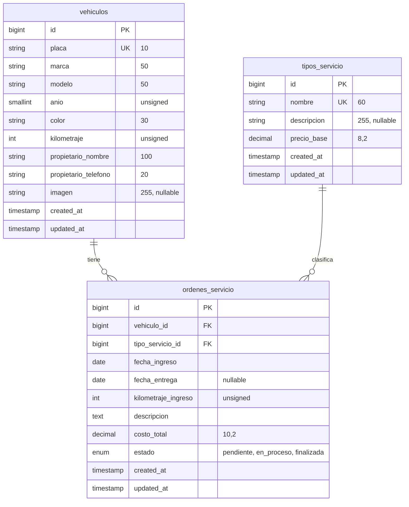

# Biela

*Fichas de vehículos y órdenes de servicio*

Proyecto final de **Desarrollo Web con Software Libre**, Facultad de Ingeniería y Arquitectura, Universidad Católica de El Salvador (UNICAES).
Caso 8, Taller mecánico. Equipo 8.

| Integrante | Usuario de GitHub |
| --- | --- |
| Carlos | por confirmar |
| Ángel | por confirmar |
| Jorge | por confirmar |
| Leonel | por confirmar |
| Fernando | por confirmar |
| Milton | por confirmar |

## 1. Descripción

Biela registra los vehículos que ingresan a un taller mecánico y las órdenes de servicio que se les realizan. El nombre es el de la pieza que une el pistón con el cigüeñal.

**Fase 1 (30 %)** incluye:

- Proyecto Laravel con conexión a MySQL o MariaDB mediante variables de entorno.
- Tres migraciones con llaves foráneas y restricciones, y tres modelos Eloquent con sus relaciones.
- Datos de prueba con factories y seeders.
- Listado paginado de vehículos con miniatura, ficha de detalle, catálogo de servicios y panel de resumen.
- Este README con el diagrama entidad-relación.

**Fase 2 (100 %)** agrega el CRUD completo, validación con Form Requests, manejo de imágenes y las reglas de negocio del caso.

## 2. Requisitos

| Requisito | Versión |
| --- | --- |
| PHP | 8.3 o superior (desarrollado con 8.4) |
| Composer | 2.x |
| Laravel | 13 (se comprueba con `php artisan --version`; desarrollado con 13.40) |
| Base de datos | MySQL o MariaDB local (XAMPP o Laragon) |

Extensiones de PHP necesarias: `pdo_mysql`, `mbstring`, `openssl`, `fileinfo`, `xml`, `curl` y `zip`.
Se comprueban con `php -m`.

La interfaz usa CSS propio, sin Bootstrap ni Tailwind, y no requiere `npm`.

## 3. Instalación

1. `git clone <url del repositorio>` y `cd proyecto-final-laravel-equipo8`
2. `composer install`
3. Copiar `.env.example` a `.env`
4. `php artisan key:generate`
5. Crear una base vacía llamada `taller_mecanico` y revisar usuario y contraseña en `.env`
6. `php artisan migrate --seed`
7. `php artisan storage:link`
8. `php artisan serve` y abrir `http://127.0.0.1:8000`

Las tablas se crean únicamente con migraciones. Solo la base vacía se crea a mano.

## 4. Modelo de datos

## 5. Tablas y relaciones

| Tabla | Modelo | Relaciones |
| --- | --- | --- |
| `tipos_servicio` | `TipoServicio` | `ordenes()` hasMany `OrdenServicio` |
| `vehiculos` | `Vehiculo` | `ordenes()` hasMany `OrdenServicio` |
| `ordenes_servicio` | `OrdenServicio` | `vehiculo()` belongsTo `Vehiculo`, `tipoServicio()` belongsTo `TipoServicio` |

Cada modelo declara su tabla con `protected $table`, porque Laravel pluraliza en inglés y buscaría `tipo_servicios` y `orden_servicios`, que no existen.
Cada modelo define `$fillable` y `casts()` para proteger la asignación masiva y tipar fechas, dinero y enteros.

### Por qué `restrictOnDelete`

Las dos llaves foráneas de `ordenes_servicio` usan `restrictOnDelete()`. Un taller no pierde el historial de un vehículo ni borra un tipo de servicio que ya tiene órdenes. En la Fase 2 el borrado mostrará un mensaje claro en lugar de una excepción.

### Reglas de negocio (pendientes para la Fase 2)

Se validarán en el servidor durante la Fase 2:

1. Placa única con formato definido por el equipo (`P` y seis dígitos, por ejemplo `P123456`).
2. Año del vehículo entre 1980 y el año actual + 1.
3. El kilometraje de ingreso no puede ser menor que el último registrado para el vehículo.
4. La fecha de entrega no puede ser anterior a la de ingreso.
5. Una orden finalizada no puede editarse.